<!-- ═══════════════ HERO ═══════════════ -->

<h1>Hey there, I'm Eric 👋</h1>

  

  

<!-- ═══════════════ ABOUT ═══════════════ -->
<h2>🌿 About Me</h2>

<table align="center" width="100%">
  <tr>
    <td width="65%" valign="middle">

💼 **Data Warehouse Engineer** @ **Ubisoft**

🕘 Previously **Data Engineer** @ **Endava**

🎓 4th-year Computer Science student @ **UPB (ACS)**

🔭 Passionate about **system design, cloud architecture, data & ETL pipelines, payments processing and web3**

🌱 Currently learning **AWS architecture, software architecting and blockchain**

⚡ Adrenaline is my passion

</td>
    <td width="35%" align="center" valign="middle">
      
    </td>
  </tr>
</table>

<!-- ═══════════════ TECH STACK ═══════════════ -->
<h2>🛠️ Tech Stack</h2>

<h4>🧠 Languages</h4>

 

<h4>⚙️ Backend & APIs</h4>

 

<h4>🗄️ Databases</h4>

 

<h4>📊 Data & AI</h4>

<h4>☁️ DevOps & Cloud</h4>

<h4>🧱 Engineering Foundations</h4>

 

<h4>🎨 Frontend</h4>

  

<!-- ═══════════════ STATS ═══════════════ -->
<h2>📊 GitHub Stats</h2>

  

 

<!-- ═══════════════ SNAKE ═══════════════ -->
<h2>🐍 Contribution Snake</h2>

<!--
  GitHub Action: create .github/workflows/snake.yml

  name: Generate Snake
  on:
    schedule:
      - cron: "0 0 * * *"
    workflow_dispatch:
    push:
      branches: [main]
  permissions:
    contents: write
  jobs:
    generate:
      runs-on: ubuntu-latest
      steps:
        - uses: Platane/snk/svg-only@v3
          with:
            github_user_name: PascuEric
            outputs: |
              dist/github-snake.svg
              dist/github-snake-dark.svg?palette=github-dark&color_snake=#00ff9d&color_dots=#0B3D2E,#14633A,#1F8A4C,#2EA043,#56D364
        - uses: crazy-max/ghaction-github-pages@v3.1.0
          with:
            target_branch: output
            build_dir: dist
          env:
            GITHUB_TOKEN: ${{ secrets.GITHUB_TOKEN }}
-->

<picture>
  <source media="(prefers-color-scheme: dark)" srcset="https://raw.githubusercontent.com/PascuEric/pascueric/output/github-snake-dark.svg">
  <source media="(prefers-color-scheme: light)" srcset="https://raw.githubusercontent.com/PascuEric/pascueric/output/github-snake.svg">
  
</picture>

  

<!-- ═══════════════ CONNECT ═══════════════ -->
<h2>📫 Connect With Me</h2>

&nbsp;

  

⭐ If you like this profile, consider leaving a star ⭐

<!-- ═══════════════ FOOTER ═══════════════ -->

